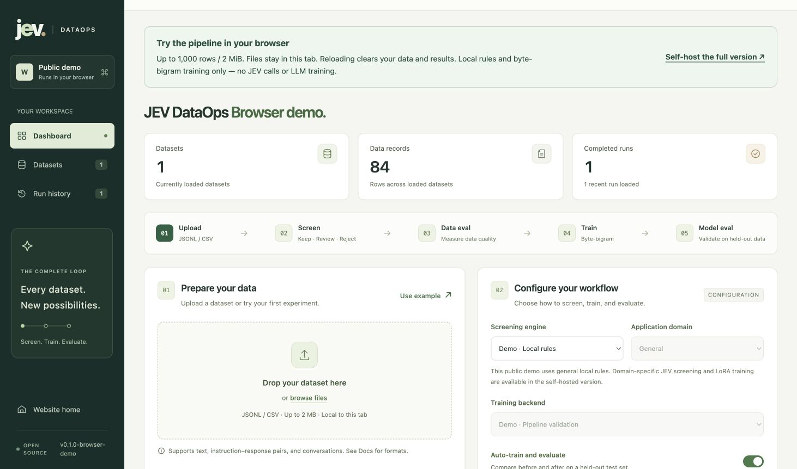
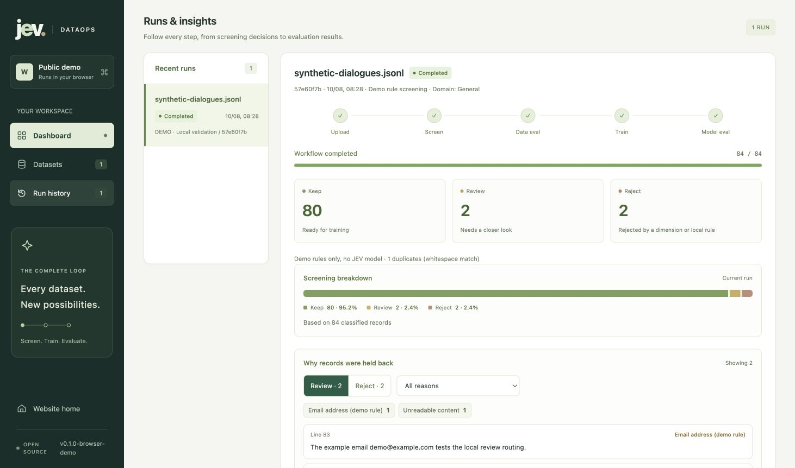

# JEV DataOps

**Turn a dataset into a training experiment you can inspect.**

Upload your data, use JEV to decide what to keep, fine-tune your model, and compare the results—all in one workbench. Every run saves the screening decisions, dataset splits, and evaluation reports so you can see what happened.

**[Try the demo](https://jev-dataops.vercel.app/demo/) · [Website](https://jev-dataops.vercel.app/) · [Get started locally](#quickstart) · [User guide](docs/USER_GUIDE.md)**

## See it in action

[](https://jev-dataops.vercel.app/demo/)

**[Open the interactive demo →](https://jev-dataops.vercel.app/demo/)** No installation, API key, or GPU needed.

1. Click **Use example** to load the bundled dataset.
2. Click **Start workflow** with the default settings.
3. Open **Runs & insights** to inspect the decisions, compare before/after results, and download the reports.

The example has 84 synthetic records: **80 kept, 2 for review, and 2 rejected**. The kept records become 56 training, 12 validation, and 12 test records.

<details>
<summary><strong>Preview a completed run</strong></summary>

[](https://jev-dataops.vercel.app/demo/)

Screenshots show the repository's public demo running locally with its bundled synthetic example. The measurements demonstrate the workflow, not JEV screening quality or LLM performance.

</details>

> **About the demo:** Files stay in your browser tab. It uses local screening rules and a small byte-bigram statistical model; it does not call JEV or train an LLM. Try your own UTF-8 JSONL or CSV file up to **2 MiB / 1,000 rows**, and download results before refreshing. [Demo details](public_demo/README.md)

## What can I do with it?

| You want to… | JEV DataOps helps you… |
| --- | --- |
| Find useful training data | Separate records into **keep**, **review**, and **reject**, with a reason for each decision |
| Understand a dataset | Inspect counts, duplicates, screening errors, and per-record audit logs |
| Test whether fine-tuning helps | Train LoRA adapters for your chosen Hugging Face model and compare loss on the same held-out data |
| Build a repeatable workflow | Use the browser, CLI, Python API, or HTTP API and keep each run's files |
| Work in a specific domain | Start with general, finance, or code screening rubrics and customize the criteria |
| Use your own training stack | Export SFT or verl GRPO/PPO bundles, including single-host multi-GPU launch options |

**JEV screens your data. Your chosen model learns from it.** This project calls JEV for judgments; it does not fine-tune JEV itself.

## Choose where to start

| | Public browser demo | Self-hosted workbench |
| --- | --- | --- |
| Best for | Trying the workflow | Screening your data and running experiments |
| Setup | [Open a browser tab](https://jev-dataops.vercel.app/demo/) | Python 3.10+ on Linux or macOS |
| Screening | Local demo rules | Local rules, JEV via OpenRouter, or JEV via TypeSafe |
| Training | Small statistical demo model | Demo model or Hugging Face LoRA; external training bundles via CLI |
| Data and results | Cleared when the tab reloads | Saved on the machine running the service |

<a id="quickstart"></a>
## Run it locally

You need **Python 3.10+, Git, and an internet connection for installation**. Start with the local demo; no provider key or model download is needed.

```bash
git clone https://github.com/RenaGao/jev-dataops.git
cd jev-dataops

python3 -m venv .venv
source .venv/bin/activate
pip install -e .

jev-dataops serve
```

Open **[localhost:8000](http://localhost:8000)** and leave the terminal running. Click **Use example → Start workflow** to complete your first run. Keep both the screening engine and training backend set to **Demo** for this first check.

<a id="data"></a>
## Bring your own data

Upload a **UTF-8 JSONL or CSV** file, then check the preview. JSONL has one JSON object per line:

```jsonl
{"group_id":"chat-001","instruction":"How do I change notification preferences?","output":"Open Settings, select Notifications, and save your preferences."}
{"group_id":"chat-002","instruction":"How do I recover my password?","output":"Select Forgot password on the sign-in page and follow the verification steps."}
```

These two rows illustrate the format. Training requires **at least 6 independent groups after screening**.

| Format | Content fields |
| --- | --- |
| Plain text | `text` |
| Instruction and answer | `instruction`, `output`, optional `input` |
| Question and answer | `prompt`, `response` |
| Conversation | `messages`, with text `role` and `content` in each item |

Use one format per record. Give records from the same conversation or document the same `group_id` or `conversation_id` so they stay in one training, validation, or test split. The default split is approximately **70% / 15% / 15% by group**.

[More examples, CSV formatting, and input limits →](docs/USER_GUIDE.md#data)

<a id="jev"></a>
## Connect JEV for real screening

Set a provider key in the terminal running your backend:

```bash
export OPENROUTER_API_KEY='your-openrouter-key'
jev-dataops serve
```

Or set `TYPESAFE_API_KEY` for a direct TypeSafe connection. Restart the service if it was already running, then select **JEV · OpenRouter** or **JEV · TypeSafe** under **Screening engine**.

For your first live run, use a small dataset and turn off **Auto-train and evaluate**. Inspect the output before training:

- **Keep:** candidate training data that passed the configured rules and gates.
- **Review:** records that need closer inspection; excluded from automatic training.
- **Reject:** records excluded with a recorded reason.

Choose **General**, **Finance**, or **Code** as a starting rubric. These are screening criteria you can adapt, not certified domain-quality checks. Keys belong in the backend environment; the workbench's connection token is a separate access-control setting.

**Live JEV screening sends the selected content fields to your chosen provider.** Redact sensitive information before submission. [Provider setup, thresholds, request budgets, and retries →](docs/USER_GUIDE.md#jev)

<a id="training"></a>
## Fine-tune your model

Install training dependencies in the same virtual environment and select a model:

```bash
pip install -e '.[train]'
export JEV_BASE_MODEL='HuggingFaceTB/SmolLM2-135M'
jev-dataops serve
```

Restart a running service, choose **Hugging Face · LoRA** in the workbench, and enable **Auto-train and evaluate**. Keep your provider key configured if you also want JEV screening. Screening and training are separate settings.

The workbench trains on kept records, keeps related records in the same split, and measures loss before and after training on held-out data. Training runs **on your backend machine**; the public website does not supply compute. Model files may download on the first run, and memory requirements depend on the model.

The defaults are a small trial: **1 epoch, at most 20 steps, batch size 4, sequence length 256**. Adjust them before running a full experiment. Saved LoRA adapters need the original base model for inference.

[Training configuration](docs/TRAINING.md) · [SFT / GRPO / PPO bundles](docs/TRAINING_ENVIRONMENTS.md) · [Multi-GPU setup](docs/MULTI_GPU.md)

<a id="results"></a>
## Understand the results

Start with **Runs & insights**. Open **Why records were held back** to inspect review and rejected records by reason. In live JEV mode, you can also inspect each record’s dimension-level judgments. Download files from **Artifacts & reports**:

| File | What it tells you |
| --- | --- |
| `keep.jsonl`, `review.jsonl`, `reject.jsonl` | Where each record went |
| `audit.jsonl` | Why each screening decision was made |
| `data_report.json` | Data counts, screening completion, and effective settings |
| `training_report.json` | What actually trained: settings, steps, and loss history |
| `model_report.json` | Before/after loss and perplexity on held-out data |

A negative **`delta_loss`** means loss decreased on that test set. Check the data split and actual training steps before interpreting the number. **Retention rate and JEV confidence are not measured accuracy; lower loss does not establish better business outcomes.** Use an independent task benchmark and human review to assess quality. Demo metrics use bytes; LLM metrics use tokenizer tokens, so they are not directly comparable.

The local workbench saves runs under **`.jev-dataops/`** in your working directory. [File layout and metric definitions →](docs/USER_GUIDE.md#results)

<a id="automation"></a>
## Prefer the command line?

Run the complete local demo from the repository root:

```bash
jev-dataops run --input examples/dialogues.jsonl --output runs/my-first-demo
```

Use a new output directory for each training experiment. For screening only, add `--trainer none`; for live JEV, configure your key and choose `--provider openrouter` or `--provider typesafe`.

[CLI and HTTP examples](docs/USER_GUIDE.md#automation) · [Python API](docs/TRAINING.md#python-api)

<a id="faq"></a>
## Common questions

| Question | Where to start |
| --- | --- |
| JEV says “Not configured.” | Set the provider key in the backend environment, restart the service, then refresh the page |
| Can I upload an Excel workbook? | Export it as UTF-8 CSV first; direct `.xlsx` uploads are not supported |
| Why did training stop with too few groups? | You need at least 6 independent groups after screening. Keep related records grouped together |
| Why did training finish so quickly? | The default 20-step limit checks the workflow; increase it for a full experiment |
| Can I use this for audio or human annotation? | Audio quality evaluation and a per-record annotation workbench are not implemented |

[More troubleshooting and recovery options →](docs/USER_GUIDE.md#faq)

<a id="scale"></a>
<a id="development"></a>
## Go further

| Guide | Use it to… |
| --- | --- |
| [User guide](docs/USER_GUIDE.md) | Find detailed setup, limits, API examples, and troubleshooting |
| [Domain adaptation](docs/DOMAIN_GUIDE.md) | Define screening criteria and a domain-specific evaluation plan |
| [Domain metrics](docs/METRICS.md) · [Browse six packs](https://jev-dataops.vercel.app/metrics/) | Score your predictions with general, finance, code, enterprise, legal, or medical-literature metrics |
| [Larger datasets](docs/USER_GUIDE.md#scale) · [Benchmarks](docs/BENCHMARKS.md) | Understand streaming, caching, and the limits of the single-host workbench |
| [Docker setup](docs/USER_GUIDE.md#development) · [Deployment](docs/DEPLOYMENT.md) | Run with Docker and configure access controls |
| [Website and demo](docs/WEBSITE.md) | Build or host the public site |
| [Contributing](CONTRIBUTING.md) | Set up development and contribute a change |

Licensed under [MIT](LICENSE). Model weights and provider APIs have their own terms. This is an independent community project, unaffiliated with TypeSafe or OpenRouter. [Security reporting](SECURITY.md)
